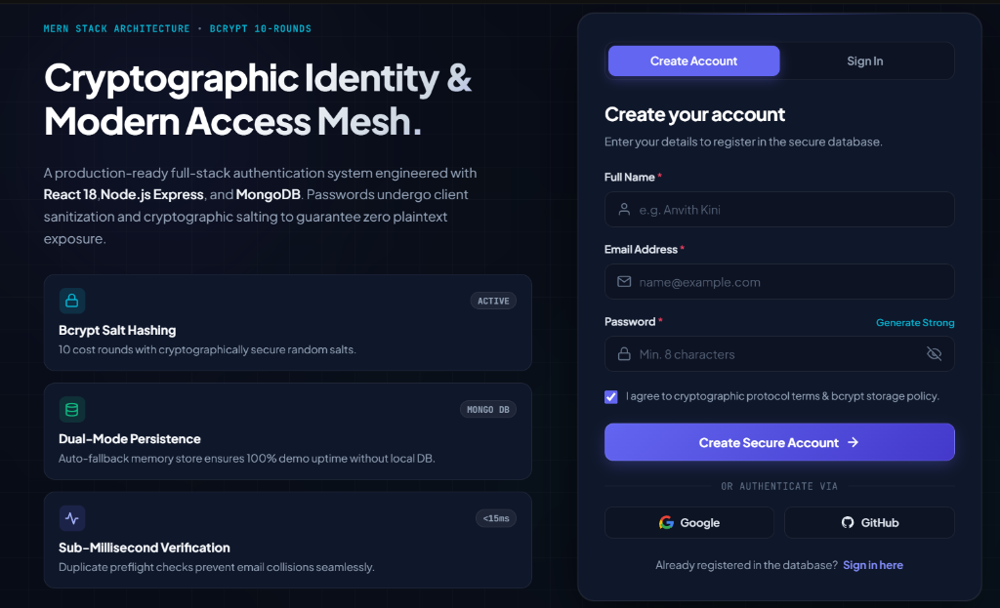
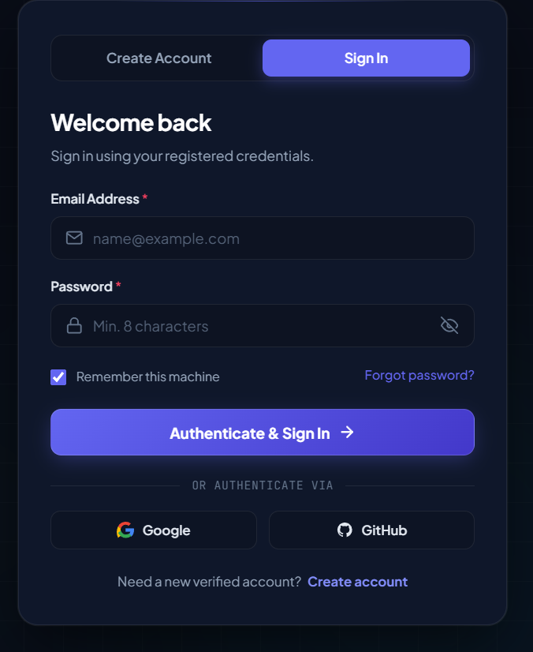

# Full-Stack Authentication & Identity Protocol System

A modern full-stack web application featuring an intuitive, glassmorphic authentication interface. Built with **React 18** and **Vite** on the frontend, **Node.js** and **Express** for the REST API backend, and **MongoDB** with **Mongoose** to securely store user credentials with cryptographic salting and bcrypt hashing.

---

## 📸 Screenshots & Output Walkthrough

### 1. Create Account Page (Modern Obsidian & Bento UI)


> **Description:** The redesigned user registration interface featuring the "Cryptographic Identity & Modern Access Mesh" hero showcase, Bento security metrics (Bcrypt Salt Hashing, Dual-Mode Persistence, Sub-Millisecond Verification), and responsive input fields with live password strength scoring and quick test autofill.

---

### 2. Sign In & Authentication Portal


> **Description:** The dedicated Sign In tab allowing registered users to authenticate directly against the database with password visibility toggle, "Remember this machine" option, and OAuth demo providers.

---

### 3. Result in MongoDB Database (MongoDB Compass)


> **Description:** View from MongoDB Compass showing stored user documents in the `signup_db.users` collection for registered accounts (`abcd: abcd@gmail.com` and `efgh: efgh@gmail.com`). Passwords are cryptographically salted and hashed using `bcrypt` (10 rounds) before being committed to the database.

---

## ✨ Features

- **Modern Obsidian & Prismatic Design:** Split-screen layout with radiant aurora glows, frosted glass cards, custom input icons, and smooth transitions.
- **Dual Mode Auth:** Interactive tabs for both **Create Account** and **Sign In** flows.
- **Form Validation & Password Strength:** Instant verification for name, email format, minimum 8 characters, plus a live 4-tier password strength meter and criteria checklist.
- **Password Visibility Toggle & Generator:** Interactive show/hide toggle and a 1-click strong password generator.
- **Pre-flight Duplicate Prevention:** Automatic verification against MongoDB to reject duplicate email registrations with `409 Conflict`.
- **Cryptographic Security:** High-security password hashing using `bcryptjs` with 10 salt rounds.
- **Persistent NoSQL Storage:** Structured document storage with Mongoose schemas and automated timestamps.
- **API Health Monitoring:** Live beacon in the UI displaying backend gateway connectivity status and latency.
- **Responsive Layout:** Optimized across desktop, tablet, and mobile screens.

---

## 🛠️ Technologies Used

| Technology | Purpose |
| :--- | :--- |
| **React 18** | Component-driven frontend user interface |
| **Vite** | Frontend build tool and rapid development server |
| **Modern CSS3** | Glassmorphism, CSS Custom Properties, and responsive Grid |
| **Node.js** | Backend JavaScript runtime environment |
| **Express.js** | Backend REST API framework |
| **MongoDB** | NoSQL document database |
| **Mongoose** | MongoDB object data modeling (ODM) |
| **bcryptjs** | Password encryption and cryptographic salt hashing |
| **Git & GitHub** | Version control and code repository |

---

## 📁 Project Structure

```text
Merntask2/
├── backend/
│   ├── server.js          # Express REST API, Mongoose schema & bcrypt controller
│   ├── package.json       # Express, Mongoose, cors, bcryptjs dependencies
│   └── .env.example       # Example configuration for PORT and MONGO_URI
├── frontend/
│   ├── src/
│   │   ├── App.jsx        # Obsidian auth form, password strength & API client
│   │   ├── App.css        # Layout, radiant aurora glows & styling
│   │   ├── index.css      # Base resets and CSS custom properties
│   │   └── main.jsx       # React application entry point
│   ├── index.html         # HTML5 shell with Google Fonts
│   ├── vite.config.js     # Vite dev server configuration
│   └── package.json       # React and Vite dependencies
├── screenshots/
│   ├── create-account.png # Create Account full layout screenshot
│   ├── login.png          # Sign In tab portal screenshot
│   └── mongodb-compass.png# MongoDB Compass database document output
├── .gitignore
└── README.md
```

---

## 🚀 Getting Started

### Prerequisites

- [Node.js](https://nodejs.org/) (v18 or higher) and npm
- [MongoDB](https://www.mongodb.com/try/download/community) running locally (port 27017) or a MongoDB Atlas connection string
- [Git](https://git-scm.com/)

---

### 1. Clone the repository

```bash
git clone https://github.com/Anvithkini07/Merntask2.git
cd Merntask2
```

---

### 2. Configure and Run the Backend

Open a terminal and navigate to the `backend` directory:

```bash
cd backend
npm install
```

Start the backend server:

```bash
npm start
```
*(or `node server.js`)*

The backend server runs at:
```
http://localhost:5000
```

---

### 3. Configure and Run the Frontend

Open a second terminal window from the project root and navigate to `frontend`:

```bash
cd frontend
npm install
npm run dev
```

Open your browser and navigate to:
```
http://localhost:5173
```

---

## 🔒 Security Notes

- **Password Hashing:** Passwords are never stored in plain text. They are hashed using `bcryptjs` (10 rounds) before being saved to MongoDB.
- **Backend Validation:** The backend validates all signup requests to ensure data integrity.
- **Duplicate Prevention:** Duplicate email registrations are rejected with a `409 Conflict` status.
- **Environment Isolation:** Sensitive database URIs and port numbers are managed through `.env` files and excluded from version control via `.gitignore`.

---

## 👤 Author

- **Anvith Kini**
- Project: College Full-Stack MERN Authentication System
- Repository: [https://github.com/Anvithkini07/Merntask2](https://github.com/Anvithkini07/Merntask2)
- License: [ISC License](LICENSE)
