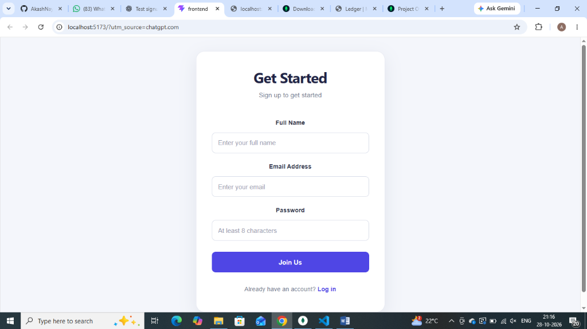
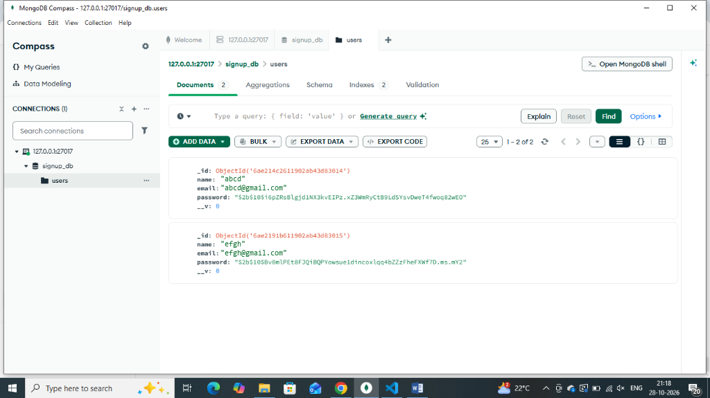

# Full-Stack Authentication & Identity Protocol System

A modern full-stack web application that allows users to create an account through an intuitive, glassmorphic registration interface. The application uses **React** and **Vite** for the frontend, **Node.js** and **Express** for the REST API backend, and **MongoDB** with **Mongoose** to store user credentials with cryptographic salting and hashing.

---

## 📸 Screenshots & Output Walkthrough

### 1. Login / Signup Page


> **Description:** The user registration and login interface featuring clean input fields for Full Name, Email Address, and Password with a "Join Us" submission button and link to log in.

---

### 2. Submission of Filled Details


> **Description:** Form filled with user credentials (`Name: abcd`, `Email: abcd@gmail.com`) and successfully submitted. The confirmation message (`"Account created successfully!"`) is displayed directly upon verification.

---

### 3. Result in MongoDB Database (MongoDB Compass)


> **Description:** View from MongoDB Compass showing the stored user documents in the `signup_db.users` collection for registered accounts (`abcd: abcd@gmail.com` and `efgh: efgh@gmail.com`). Passwords are cryptographically salted and hashed using `bcrypt` (10 rounds) before being committed to the database.

---

## ✨ Features

- **Modern Glassmorphic UI:** Split-screen layout with radiant atmospheric glows, custom input icons, and smooth transitions.
- **Form Validation & Password Strength:** Instant verification for name, email format, minimum 8 characters, plus a live 4-tier password strength meter.
- **Password Visibility Toggle:** Interactive show/hide toggle for password inspection.
- **Pre-flight Duplicate Prevention:** Automatic verification against MongoDB to reject duplicate email registrations with `409 Conflict`.
- **Cryptographic Security:** High-security password hashing using `bcryptjs` with 10 salt rounds.
- **Persistent NoSQL Storage:** Structured document storage with Mongoose schemas and automated timestamps.
- **API Health Monitoring:** Live beacon in the UI displaying backend gateway connectivity status.
- **Responsive Layout:** Optimized across desktop, tablet, and mobile screens.

---

## 🛠️ Technologies Used

| Technology | Purpose |
| :--- | :--- |
| **React** | Component-driven frontend user interface |
| **Vite** | Frontend build tool and rapid development server |
| **Modern CSS3** | Glassmorphism, CSS Custom Properties, and responsive Grid |
| **Node.js** | Backend JavaScript runtime environment |
| **Express.js** | Backend REST API framework |
| **MongoDB** | NoSQL document database |
| **Mongoose** | MongoDB object data modeling (ODM) |
| **bcryptjs** | Password encryption and cryptographic salt hashing |
| **Git & GitHub** | Version control and code repository |

---

## 📂 Project Structure

```text
Merntask2/
├── backend/
│   ├── server.js          # Express REST API, Mongoose schema & bcrypt controller
│   ├── package.json       # Express, Mongoose, cors, bcryptjs dependencies
│   └── .env.example       # Example configuration for PORT and MONGO_URI
├── frontend/
│   ├── src/
│   │   ├── App.jsx        # Glassmorphic auth form, password strength & API client
│   │   ├── App.css        # Cyber-slate layout, radiant glows & styling
│   │   ├── index.css      # Base resets and CSS custom properties
│   │   └── main.jsx       # React application entry point
│   ├── index.html         # HTML5 shell with Google Fonts
│   ├── vite.config.js     # Vite dev server configuration
│   └── package.json       # React and Vite dependencies
├── screenshots/
│   ├── signup.png
│   ├── registration-success.png
│   └── mongodb-compass.png
├── .gitignore
└── README.md
```

---

## ⚙️ Getting Started

### Prerequisites

- [Node.js](https://nodejs.org/) (v16 or higher) and npm
- [MongoDB](https://www.mongodb.com/try/download/community) running locally (port 27017) or a MongoDB Atlas connection string
- [Git](https://git-scm.com/)

---

### 1. Clone the repository

```bash
git clone https://github.com/Anvithkini07/Merntask2.git
cd Merntask2
```

---

### 2. Configure and Run the Backend

Open a terminal and navigate to the `backend` directory:

```bash
cd backend
npm install
```

Create a `.env` file inside the `backend` folder (or copy `.env.example`):

```env
PORT=5000
MONGO_URI=mongodb://127.0.0.1:27017/signup_db
```

> **Note:** Ensure your MongoDB service is running locally on your computer, or provide your cloud MongoDB Atlas URI.

Start the backend server:

```bash
npm start
```
*(or `node server.js`)*

The backend server runs at:
```
http://localhost:5000
```

---

### 3. Configure and Run the Frontend

Open a second terminal window from the project root and navigate to `frontend`:

```bash
cd frontend
npm install
npm run dev
```

Open your browser and navigate to:
```
http://localhost:5173
```

---

## 🔐 Security Notes

- **Password Hashing:** Passwords are never stored in plain text. They are hashed using `bcryptjs` (10 rounds) before being saved to MongoDB.
- **Backend Validation:** The backend validates all signup requests to ensure data integrity.
- **Duplicate Prevention:** Duplicate email registrations are rejected with a `409 Conflict` status.
- **Environment Isolation:** Sensitive database URIs and port numbers are managed through `.env` files and excluded from version control via `.gitignore`.

---

## 👨‍💻 Author

- **Anvith Kini**
- Project: College Full-Stack MERN Authentication System
- Repository: [https://github.com/Anvithkini07/Merntask2](https://github.com/Anvithkini07/Merntask2)
- License: [ISC License](LICENSE)
